# 旧版阅读图连线标签层级验收

验收日期：2026-10-30。将旧版阅读图的关系标签移入独立 HTML 层，使用不透明白底；React Flow 采用手动层级，固定分组背景 0、连线 1、标签 2、节点卡片 3，避免父子分组自动提升连线后再次覆盖文字。

- 在用户 8765 开发页面和独立历史库的发布构建中核对配置迁移旧图：11 个关系标签均位于标签层，SVG 连线层级为 1，不再穿过文字；节点卡片仍高于标签。
- 键盘 Enter 可从关系标签打开对应调用位置的完整历史源码。未修改图文档、连线端点或原始历史库。
- 68 项 Node 测试及前端构建通过。实际截图：`references/screenshots/reading-edge-labels-fixed.png`。

# 完整快照源码与引用标记验收

验收日期：2026-10-30。源码检查窗默认连续浏览完整文件，使用虚拟行与按需分块读取；不再替换“上一段／下一段”。

- 实际 `desktop/src/main.ts`（快照 f7d24978，994 行）：首次定位 L656，完整依据 L656–992 使用深色标记，当前对象的其他范围使用浅色。Home 可读 L1，End 可读 L994；引用导航可在 L500、L656、L710 间跳转，解释保持不变。
- 该文件只创建约 30–40 行 DOM。文件末尾切换图面模式前后 scrollTop 均为 22568，正文没有被模式切换重置。
- 从目录打开与当前对象无关的 `desktop/src/agent.ts`，可读完整正文，引用标记为 0，并说明“当前对象未关联此文件”。
- 隔离组件页运行实际组件与开发环境 StrictMode，加载十万行文件：可达第 100000 行，末尾仅 30 行 DOM；切到另一文件不混入旧内容。补齐函数元数据前后 scrollTop 均为 15328.5。
- 模拟区段读取失败后，其余行保持可读；用实际指针点击可见的“重试此段”，失败行恢复，重试前后 scrollTop 均为 6768.5。错误入口始终位于当前可见区段内，窄区宽度不足时文字省略，按钮保持可见。
- 宽屏 1600×1000、会话展开以及窄屏 650×900 均验证；窄屏源码与解释上下排列，无页面横向溢出。键盘 Home／End、引用跳转及检查窗调高正常，控制台无错误或警告。

68 项 Node 测试、4 项源码快照回归和 9 项 UML 来源／渲染回归通过；前端构建通过，离线产物同步。缓存最多 12 块、并发最多两项，覆盖失败重试、迟到响应、关闭取消、范围合并、快照身份及文件删除后重组完整历史正文。不修改公开 API 或图文档，不调用模型。

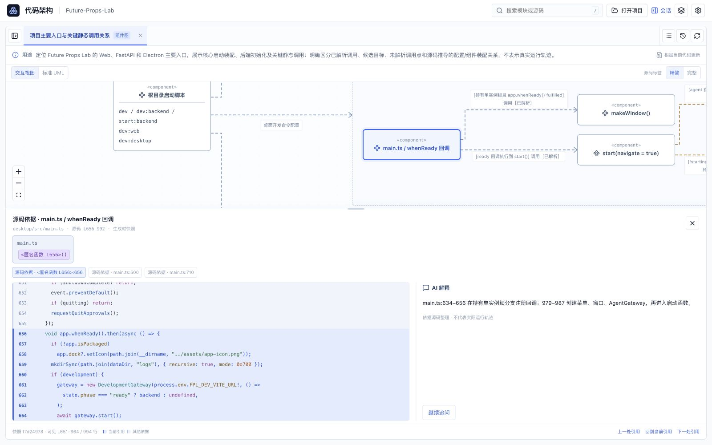

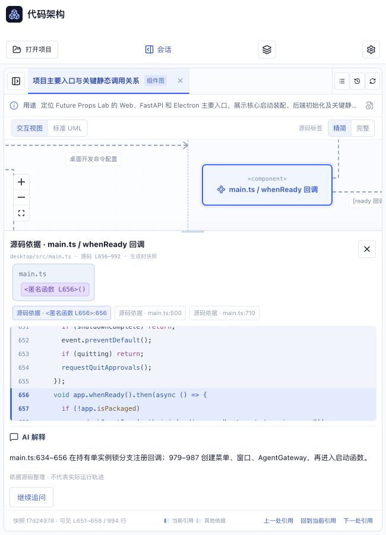

---

# 精简／完整源码显示验收

验收日期：2026-10-30。按钮已改为“精简／完整”，默认精简，项目偏好迁移为 `simple／full`（兼容原 `folded／expanded`）。仅在交互视图显示开关。

- 原 28 节点、27 关系复杂图：精简模式的画布和测量节点均没有源码标签 DOM、函数标签或 `+N`；完整模式恢复完整嵌套文件与函数标签。两种模式均无节点内容溢出、关系标签相互覆盖或关系标签覆盖节点。
- 两种模式的底部检查窗都显示完整文件名、函数及调用／定义位置；键盘 Enter 可打开节点和关系依据，目录继续高亮。
- 普通节点、容器标题和关系标签均实测切换前后屏幕中心一致。标签与其测量后的布局一起更新，避免先把完整内容塞进旧尺寸；容器头部按实际 DOM 锚定。
- 旧折叠偏好实测迁移到精简，新建隔离项目默认精简；完整模式刷新后恢复。标准 UML 中隐藏开关，返回交互视图保留原模式。
- 隔离时序示例实测：精简头部及生命线起点为 70px，完整为 113px，全部消息端口同步移动 43px，五条消息顺序保持一致。
- 1600×1000 检查会话与源码窗同时展开；650×900 实测画布宽 636px，无页面横向溢出，底部源码标签完整保留。浏览器控制台无错误或警告。

61 项 Node 测试及前端构建通过，离线产物已同步。新增实际 React 节点渲染测试、偏好迁移与无证据占位几何测试；后端接口和图文档未修改，切换不调用模型。

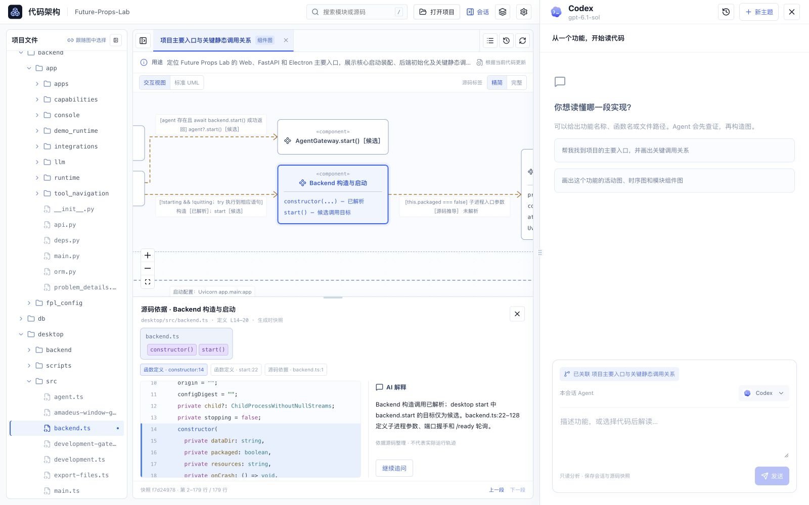

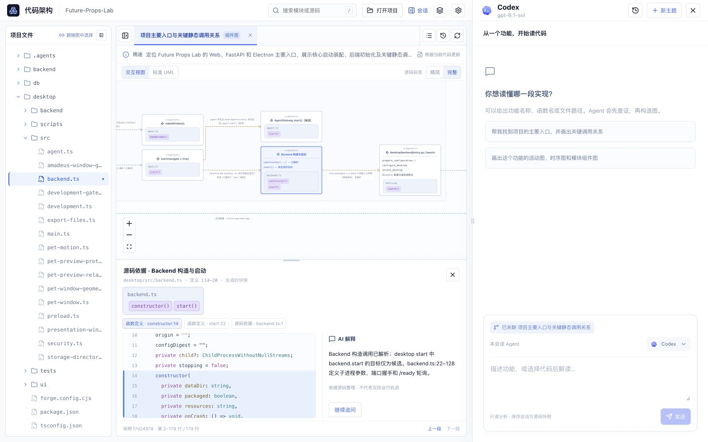

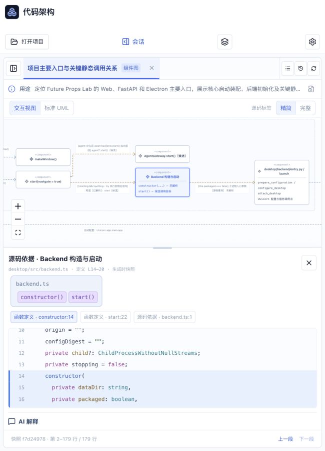

---

# 复杂组件图文字重叠修复

验收日期：2026-10-30。使用实际生成的“项目主要入口与关键静态调用关系”复现：28 个节点、27 条关系，包含 Web、Electron、FastAPI 容器、长条件、多行成员及多文件源码标签。

此前的小图检查没有覆盖这种密度。旧实现按成员数量估算高度，未计入真实换行；同时丢弃 ELK 的连线路由和标签坐标，重新计算中点标签，导致节点溢出和连线文字压住节点。

本轮改为排版前测量真实 DOM 尺寸，向 ELK 提交文字占位，并保留其折线路径及标签坐标。选中边框保持相同占位；容器标题和源码标签固定在头部；旧视口指向空白时恢复可读位置。

浏览器实测：

- 1600×1000，分别在源码标签折叠／展开、会话和源码窗同时打开时检查。两种模式的节点内容溢出、关系标签相互覆盖、关系标签覆盖节点或容器标题均为 0。
- 650×900，保留选中节点与源码窗，选中节点位于画布内，无页面横向溢出。
- 标签仍能打开函数定义和关联目录，源码及解释正常；浏览器控制台无错误或警告。

58 项 Node 测试通过，前端构建通过并同步离线产物。新增真实复杂图的几何回归、嵌套坐标与正交路由、带长标签活动链和空白视口恢复测试。此次仅修改前端排版，未改后端接口。

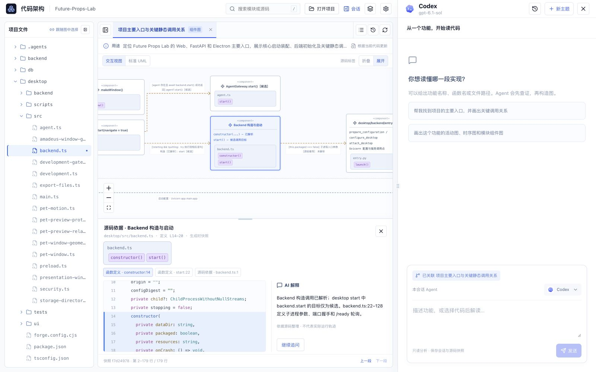

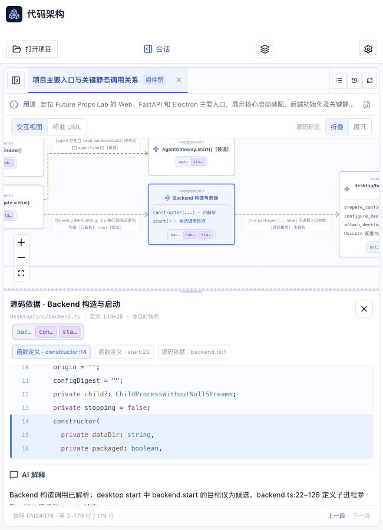

---

# 嵌套源码标签与双 UML 视图验收

验收日期：2026-10-30。final result: passed。实现依据为已确认的源码标签局部图；业务名称保持为节点标题，文件容器直接包含函数标签，不叠加重复外框。

## 本轮实际检查

- 使用隔离项目与真实配置迁移源码回归副本，在 1600×1000 宽屏、会话展开及 650×900 窄屏测试离线构建。
- 折叠／展开的文件与函数标签均通过 DOM 边界检查确认真实包含；名称前缀冲突、多文件与多函数分组有单元覆盖。展开后文件容器填满节点内容宽度。
- 标签点击、Tab 焦点提示与 Enter 定位均已实测。点击 `publish()` 打开定义 L31–46，不被外层节点再次选择覆盖；业务节点打开调用处 L79，L76、L77、L80 与 `convert_legacy()` 归属保持一致。
- 切换标签尺寸后，选中节点屏幕中心误差小于 0.001px。时序图按统一头部高度调整生命线与消息，保留消息顺序。
- 七类标准 UML 均用已安装的私有 Java 21＋PlantUML MIT 实际离线渲染，并通过图中键盘入口打开原检查窗。无文字关系提供可聚焦的依据入口。
- 标准图在打开检查窗、展开会话及缩窄窗口后保持所选元素可见；窄屏无页面横向溢出，源码与解释改为上下排列。
- 修复源码读取与函数索引并发时元数据被旧响应覆盖的问题；过期请求仍由原请求门控与取消机制处理。Esc 关闭源码检查窗后回到图操作区域。
- 最终浏览器控制台无错误或警告。运行时校验失败重试、超时释放并发槽位、缓存命中、历史模型不变、转义与 SVG 清理均有回归覆盖。

## 验证结果

`node --test assets/board-source/tests/*.test.mjs`：55 项通过。

`python3 -m unittest discover -s tests -v`：170 项通过。

前端构建通过，离线产物已同步。构建仍报告既有的大体积 bundle 提示。Python 回归中修正了既有 CLI 测试的启动时限波动：仅对其验证的可选 `--help` 请求使用短超时，模型目录查询保留独立充足时限，仍执行真实子进程超时路径。

## 实际截图与参考

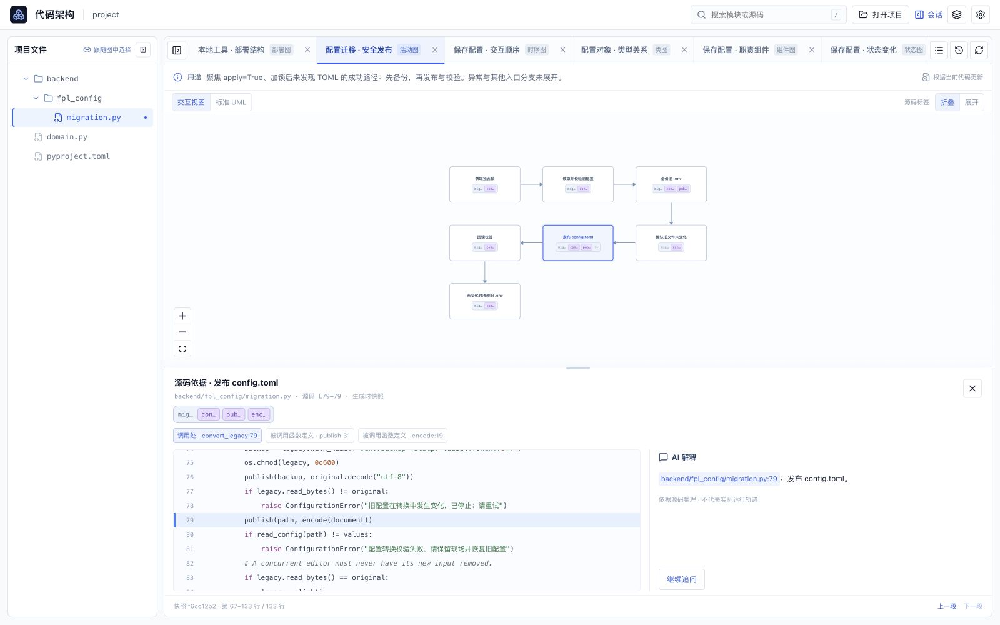

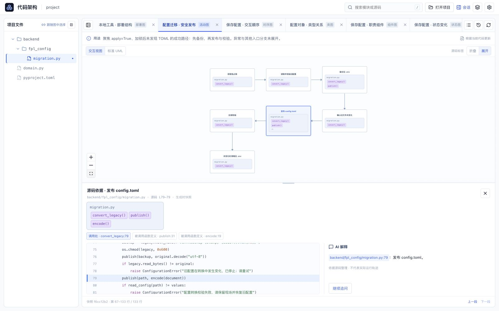

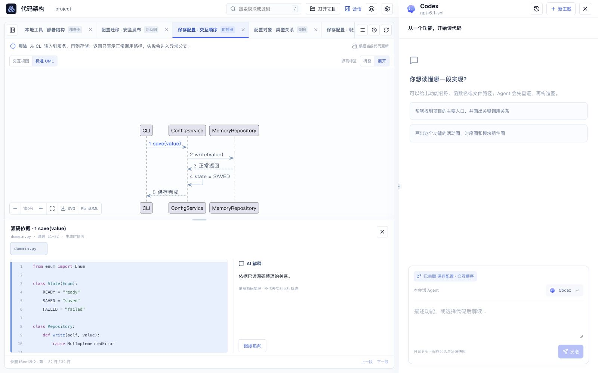

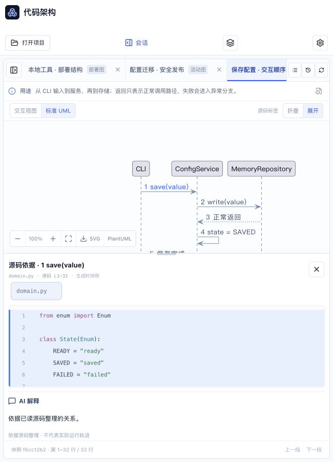

参考图保存在 `references/screenshots/source-tags-design.png`。复杂活动图仅在结构可无损转换时生成标准 UML；不支持的结构显示原因并保留交互图。当前锁定运行时包覆盖 macOS／Linux arm64 与 x64，未锁定的平台明确显示不可用。

---

# 项目 UML 工作区验收

验收日期：2026-10-29。目标是把选定的多 Tab 预览落实为可操作工作区，保留目录、图、会话及按需打开的源码检查窗。图的连接以源码为准，不复制预览中的错误旁路。

## 视觉与交互

实际运行离线构建，用浏览器检查 1920×1080、1600×1000、1000×900、650×900。

| 场景 | 实测结果 |
| --- | --- |
| 宽屏、会话展开 | 左目录、中 UML、右会话；底部源码与解释并排；无重复常驻源码区、全局面包屑或统计栏。 |
| 多图 | 活动、时序、类、组件、状态、用例、部署七种图均打开；图名、类型及用途可见，长标签横向滚动。 |
| 目录联动 | 节点和连线自动展开关联文件；主文件整行高亮，其他文件保留关联标记。部署示例切换 domain.py 与 pyproject.toml 的依据位置。 |
| 关闭与恢复 | 关闭 Tab 后从项目图列表重新打开，选择保持；切换 Tab 前后的视口变换一致。 |
| 项目与会话 | 打开另一隔离项目显示独立图集；返回恢复标签。切换阅读历史会话后，活动图和标签顺序保持。 |
| 历史版本 | 实际建立 v2，版本列表回到 v1 后仍能读取原 L80；历史版本禁用直接更新，返回最新版本后恢复。 |
| 源码变化 | 在隔离项目插入一行注释，再移动 migration.py。自动检查显示修改，手动扫描后显示删除；历史文件入口仍打开原 L76/L79/L80，不猜测新路径。 |
| 窄窗口 | 中间空间不足时目录改为遮罩抽屉；650px 无页面横向溢出，检查窗源码与解释上下排列。会话保留原有覆盖／全屏行为。 |
| 键盘 | Enter 打开节点和连线依据；位置引用可操作。检查窗分隔条上方向键增加 24px，目录分隔条右方向键增加 24px；Esc 关闭检查窗／概览。 |
| 弹出层与错误 | 图列表、版本菜单限制在容器内；最终浏览器控制台无警告或错误。 |

宽屏实际截图：

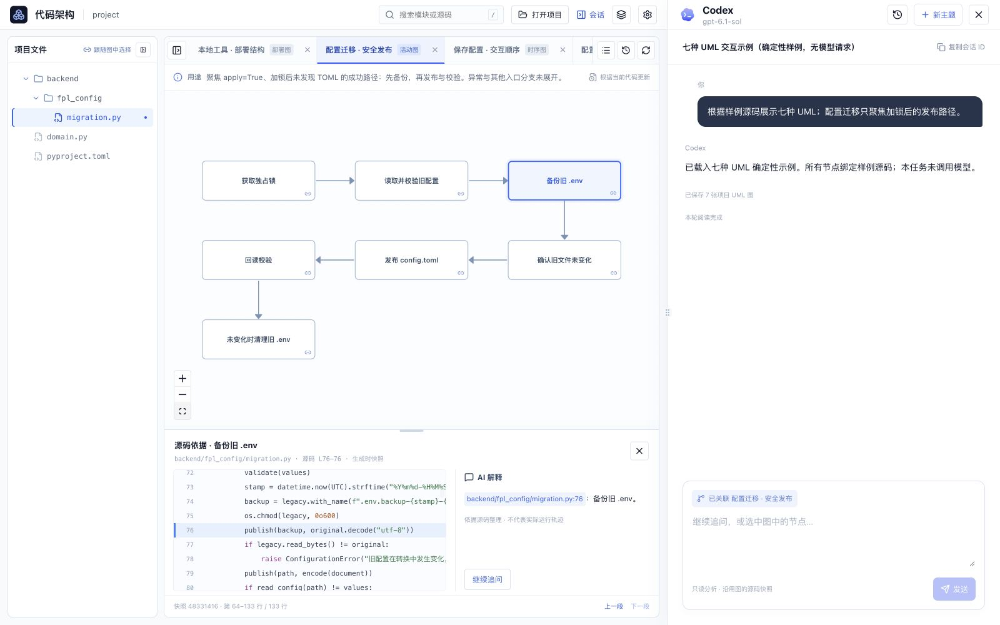

窄屏实际截图：

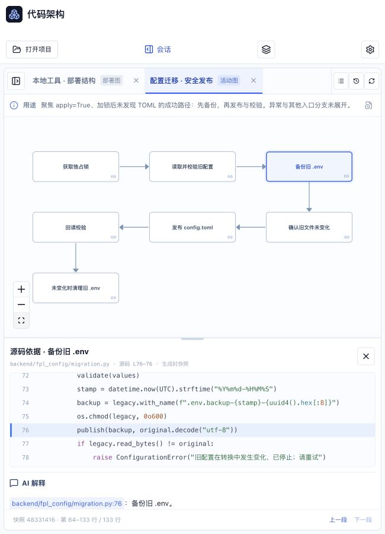

## 源码和图形核对

配置迁移使用真实源码的固定回归副本：L63–65 取得锁，之后 L69–72 读取与校验，L76 发布备份，L77 检查原文件未变化，L79 发布 TOML，L80 回读校验。示例明确限定为成功路径，异常与其他入口没有冒充必经顺序。

时序图按消息排序，返回虚线和自身调用分别绘制；类图显示成员分隔和空心继承箭头；组件显示职责依赖；状态图使用源码枚举及赋值；用例图包含角色和系统边界；部署图采用配置中明示的嵌套结构。

浏览器检查发现并修复：继承 marker 引用重复包装导致箭头消失、长活动链初始缩放过小、配置文件未纳入目录、解释引用未定位源码、无文字关系缺少键盘打开行为。长无分支活动链折行保留原端点与顺序，图形适应窗口变化时保持选择和缩放。

## 自动回归

- `node --test assets/board-source/tests/*.test.mjs`：47 项通过。
- `python3 -m unittest discover -s tests -v`：161 项通过（47.615s）。
- `npm --prefix assets/board-source run build`：通过，离线产物同步。
- `git diff --check`：通过。

Python 回归包括七种合约、多图原子保存、共享与隔离、并发冲突、旧图幂等迁移、证据与源码范围验证，以及失败、取消、中断时保留原图。五种 CLI 通过真实 MCP 桥的确定性协议夹具验证生成与更新，不调用 LLM；浏览器七图也由相同的验证和存储入口建立。实际模型输出仍由运行时校验约束，本次未为验收消耗模型额度。

## 当前边界

实现有类型与依据的源码阅读 UML 子集，不是完整 UML 建模编辑器；无需执行目标项目。构建仍有现有 React Flow／ELK 依赖体积提示，不影响离线运行。源码改名按旧路径删除呈现，旧快照保留，更新需用户明确发起；运行时调用栈、实时变量值和自动行号迁移不在本次范围。

---

## 早期功能验收记录

以下保留此前版本的实测记录；其中旧主界面已由本次 UML 工作区替代。

# 工程统计与源码呈现验收

## 右侧通高会话滑窗验收（2026-10-28）

final result: passed

- **图稿与证据**：使用用户选定的 `exec-4222f652-d6d4-4dfe-b109-d58b74b7a9a6.png`；实际页面为 `http://127.0.0.1:64123/`，在应用内浏览器以 1586×992 CSS px 捕获，与原图相同尺寸。原始截图未修改；本地分析接触表并排展示图稿和实现。
- **完整对照**：`/Users/tonghao/.codex/visualizations/2026/10/28/01a1808f-8b09-7e72-8eaa-9e37dd8044bb/drawer-qa-comparison.png`；右栏细节对照为同目录 `drawer-qa-detail.png`；实际桌面和手机截图为 `agent-drawer-desktop.png`、`agent-drawer-mobile.png`。
- **状态差异说明**：图稿使用四个虚构文件和示意回复，实际验收使用隔离测试项目的两个真实函数及模拟 CLI 的历史回复。保留现有“代码地图 / 功能解读”入口、固定 Agent、真实模型配置与静态证据，不把示意图的数据写入产品，也不声称真实模型联调已通过。
- **布局与间距**：右栏 `top=0`、高 992px，默认宽 529px；左侧页头、统计和图随之收窄。输入框距视口底部 24px，头部 72px、主题行 56px，正文左右 28px。没有暗色遮罩或重复的内嵌会话栏。
- **字体**：沿用项目系统中文字体；会话正文 14px、标题 16px、模型信息 12px。主题名保留省略和完整提示，模型未覆盖时如实显示 CLI 默认来源。
- **颜色与图像**：沿用白底、冷灰边界、蓝色操作和深蓝用户消息；使用已有 Agent SVG 品牌素材及 Lucide 控件，无新增占位位图。工具记录继续采用用户指定的单箭头摘要，不恢复圆点或重复的返回行。
- **文案与信息结构**：历史、新主题、复制会话 ID、输入框全部在滑窗内；模型/Agent 原有配置语义和源码快照提示保留。选定主题显示关联阅读图；真实内容较少时不填充虚构分析文字。
- **首轮 P2 与修复**：右栏展开后旧视口使第二个函数卡片被裁切（`drawer-before-fit.png`）。改为监听实际图容器尺寸，并以已知节点及父分组几何计算视口；节点显式保留尺寸和连接端口。复查 `allCardsVisible=true`，两节点与连线均完整可见；适应按钮也使用同一几何算法。
- **交互**：分隔条实际向左拖动 80px，宽度从 553px 增至 633px，刷新仍为 633px；双击恢复默认 529px。方向键调宽、收起/重开保留草稿、在代码地图与功能解读间往返保留草稿、阅读历史选择及源码弹窗均走通。源码弹窗的 Escape 只关闭源码，不误关会话；菜单 Escape 同理。
- **窄屏与无障碍边界**：390×844 时滑窗正好覆盖视口，页面无横向溢出，Agent 自定义菜单在视口内且无原生 select。手机使用对话框语义与键盘焦点约束；桌面保留非模态并排阅读。恢复默认视口后继续保留可检查的页面；未声称完成所有屏幕阅读器认证。
- **验证**：26 项 Node 测试、离线前端构建及 diff 空白检查通过；新增尺寸边界测试覆盖默认宽度、主图最小空间、过大/无效偏好、窄屏覆盖及桌面偏好恢复。实际交互后控制台无错误或警告。没有剩余 P0/P1/P2；已有首包体积提示作为 P3 后续优化，不在本次重构依赖范围内。

日期：2026-10-28。范围：工程统计入口、两个统计视图、目录与语言筛选、文件预览、代码浏览和技术依据中的语法高亮。

final result: passed

## 视觉依据与有意调整

- 原始图稿：`/var/folders/12/mw4nlyqd4sg40kmyjrbjnvp00000gn/T/codex-clipboard-5b8ebfd7-4f26-4b2e-a2c6-27ef2dc65b84.png`，1484 × 1060。
- 后续用户反馈优先：合并入口；取消按来源推断的分类；压缩顶部与模块页脚；去掉两个页面的大数字横栏；菜单跟随目录范围；统一代码高亮。
- 桌面实测：1484 × 1060、1280 × 800 CSS px；窄屏实测：390 × 844。截图按 CSS 像素归一化；预览截图为同尺寸 JPEG，转换 PNG 后用于对照，未修改界面内容。
- 当前实现：`.local/statistics-build/metrics-final.png`。
- 完整并排对照：`.local/statistics-build/comparison-current.png`。
- 图表细节并排对照：`.local/statistics-build/comparison-current-detail.png`。
- 更新后的只读预览：http://127.0.0.1:61718/。

## 流程与检查结果

1. **顶部与模块页脚 — 通过。** 顶部只有一个工程统计入口，桌面默认约 78px；模块摘要约 39px，移除重复查看口径入口。证据：`.local/statistics-build/board-1280.png`。
2. **代码规模 — 通过。** 直接展示行构成、语言分布、目录排名；代码、注释、空行使用实测数值。两种排名单位和目录逐级下钻有效，`web` 占比为 69.03%。移除三个大数字与来源分类。证据：`metrics-final.png`、`comparison-current-detail.png`。
3. **文件筛选 — 通过。** 语言菜单只展示当前目录的实际语言并附数量；目录切换清理旧语言与搜索；全项目语言排名可回到相应全局文件范围。搜索、空结果、重置均已验证。证据：`.local/statistics-build/dropdown-final.png`。
4. **菜单与键盘 — 通过。** 菜单按控件位置在视口内展开；390px 窄屏无横向溢出。方向键、Home/End、Enter 可选择；Escape 先关闭菜单，保留弹窗；Tab/Shift+Tab 在弹窗内循环。关闭弹窗恢复入口焦点。证据：`.local/statistics-build/mobile-menu.png`。
5. **解析详情 — 通过。** 去掉大数字横栏，将指标并入分布图和文件状态；支持范围和全部文件的分母分别保留。默认列出需要查看项，暂不支持语言单独筛选。分页验证：30 → 60 项，切回需要查看后恢复 1 项。证据：`.local/statistics-build/coverage-final.png`。
6. **源码与返回 — 通过。** Python 与 JavaScript 弹窗已实测语法高亮；关闭预览保留筛选、查询与滚动位置。技术依据片段和代码浏览也使用同一高亮器；代码浏览中点击 `math` 引用仍定位至第 166 行，目标行与符号高亮保留。证据：`.local/statistics-build/source-highlight-final.png`、`.local/statistics-build/code-browser-highlight.png`。
7. **服务与控制台 — 通过。** 检查发现旧服务缺少新代码浏览接口；已启动当前版本的只读服务，完成索引和变量定位验证。新预览没有控制台错误或警告。

## 视觉检查面

- **字体**：沿用系统中文字体与等宽代码字体，表格使用等宽数字；有意缩小辅助信息，避免重复主指标。
- **布局**：保留图稿的左侧图表、右侧解析摘要；移除横栏后目录排名和文件明细能更早出现。窄屏改为单列，内部滚动。
- **颜色**：蓝色表达规模，语言有稳定色标；青色表达解析完成，灰色表达暂不支持，琥珀色表达需要查看。行构成中的白色文字和代码注释颜色已加深以改善对比。
- **图像与图标**：该界面没有需要复刻的照片或插图；沿用项目 Lucide 图标。图表为真实数据图形，代码高亮为可选取文本。
- **文案**：无“自有源码”等归属判断；口径默认折叠；计数失败和部分计数不补成零行。

## 修复记录

- 初版顶部及大数字占位过高：按用户反馈改为紧凑入口、移除两页数字横栏，已重新捕获检查。
- 原生语言菜单样式和位置不一致，且选项来自全项目：改为视口内定位菜单及目录内选项，已验证键盘和窄屏。
- 文件预览返回会丢失筛选：保留统计视图挂载，关闭预览返回原位置，已实测 Python + `config` 查询保留。
- 模块摘要与口径入口重复：改为一行数据，已重新测量高度。
- 源码显示为单色：引入显式语言语法高亮，保留原文、行号及引用范围，已验证弹窗、代码上下文和依据片段。

## 自动检查与边界

- 前端构建通过。
- 本轮 Python 回归 61 项通过；统计与高亮 Node 测试 10 项通过。
- 测试包含未知计数、目录分区、分母、跨行注释、原文与实体保真、UTF-16 引用切片和 3000 行输入。
- 手工检查了主要键盘流程和三个视口；未声称完成所有浏览器及屏幕阅读器的全面无障碍认证。
- P3 后续优化：高亮语言包可进一步按需加载，以降低首包体积；不影响本次交互验收。

## 三层代码浏览与用户反馈修复验收

日期：2026-10-28。本节独立于上面的工程统计验收，覆盖文件依赖、函数关系、结构化逻辑与变量、架构图和面板分隔条。

final result: passed

### 依据与对照

- 用户最新反馈优先：取消原生函数下拉框、修正垂直间距、明确图的方向和焦点，并支持左右调宽。
- 原生菜单依据：`/var/folders/12/mw4nlyqd4sg40kmyjrbjnvp00000gn/T/codex-clipboard-ddb2b74e-744c-4f06-8822-ba87bd74781a.png`；工具栏依据：同目录 `codex-clipboard-2440771f-8818-4922-b926-1c11fd374c64.png`。
- 同一次视觉对照输入中查看了用户原生菜单截图和实际 FPL 页面 `.local/code-browser/ui/fpl-menu-final-1440.png`；冷色页面内菜单取代深色系统弹出框，保留函数、行号和当前项。
- 旧图使用通用网格且混合包含与调用；按用户反馈改为焦点三栏和定向层级，不复刻旧图的网格。函数图不宣称运行时入口，逻辑图明确是结构简图。

### 实际交互与尺寸

- JS/TS 和 Python 夹具均走通架构 → 文件 → 函数 → 逻辑；函数选择、自定义菜单点击及 Escape 关闭、递归标记、变量定义/引用与还原逻辑有效。FPL 实测 `setup.py` 的 `main` → `cmd_check` → 逻辑，存在两个源码返回位置。
- 返回函数层前后视口均为 `translate(18.76px, 56px) scale(0.78)`；源对象选中与菜单当前项保留。缩放未触发语义层级变化。
- 实际夹具视口为 1280×800、1440×900、1600×1000 CSS px：没有页面横向溢出，左右面板上边缘同为 212px，下边缘分别 759/859/959px；三组均有 16 条逻辑边、0 个隐藏节点。测量在 `ui/viewport-checks.json`，截图在 `ui/fixtures-final-{1280,1440,1600}.png`。FPL 菜单、函数与逻辑截图实测为 1440×900。
- 导航行上下各 12px；FPL 工具栏三个控件均高 30px、顶部 231.5px。菜单在视口内部（220×248px，top 266.5px），列表可滚动，页面没有原生 select。
- 架构分隔条指针向左拖 80px，右栏由 360px 增至 440px；代码分隔条右方向键由 540px 减至 516px。宽度按视图保存在当前服务地址下，边界限制有效。
- 选择变量前后连线仍为 16 条；真实项目逻辑连线 5 条。固定大小节点显式提供尺寸和连接端口，修复受控重绘后隐藏/丢失连线的问题。适应画布根据真实卡片几何计算，能显示函数开始和两处返回。

### 视觉检查面与修复

- 字体与图标沿用现有系统中文字体、等宽代码字体和 Lucide；界面不需要新增位图素材。函数名省略时保留源码路径和定位依据。
- 工具栏使用统一高度、基线和间隔，窄面板隐藏辅助文案；菜单为白底、浅边框、蓝色当前项，与页面相同色系。
- 图的方向提示始终可见；当前对象蓝色，候选琥珀虚线，变量引用蓝色，返回绿色、抛错红色；不只依赖颜色区分，保留文字标签。
- 修复列表：原生菜单和焦点描边不一致、导航间距不均、同页混合关系形成乱线、焦点卡片过低、图节点隐藏、重绘丢失连线、适应画布无效。各项均在实际页面重新检查。
- 本节没有未解决的 P0/P1/P2 视觉问题。控制台无错误或警告；未声称完成所有浏览器与屏幕阅读器认证。

### 自动检查与保留边界

68 项 Python 回归、7 项前端模型测试、离线资源构建、CLI 有界导出和 diff 空白检查通过。日志位于 `.local/code-browser/`。静态候选、结构化逻辑简化和大项目约 4.21 GiB 宿主峰值内存的边界详见 `references/code-browser-results.md`；不将这些边界藏在视觉通过结论中。

## 2026-10-28：左侧代码结构与右侧会话

- 代码地图、文件浏览及功能解读均使用左侧可收起的代码结构；保留树的展开与选择状态，记录面板宽度和收起偏好。会话可在三种视图中独立展开或收起。
- 实际 1280×720 页面核对：顶部导航 48px，代码地图左栏 300px；文件浏览左栏 400px，右方向键增至 424px，收起后保留展开入口。会话收起与再展开保留未发送草稿，测试草稿随后清空，未发送模型请求。
- 会话扩大到 640px 时触发左侧覆盖式抽屉，无页面横向溢出；会话宽度随后还原。源码弹窗打开和关闭正常，控制台无错误。
- 129 项 Python 回归、26 项前端测试及离线构建通过；真实 CLI 生成能力不属于本次布局验证。

## 2026-10-29：图 1 调用层级树与源码联动

final result: passed

### 视觉依据与对照证据

- 选定参考：`/Users/tonghao/.codex/generated_images/01a181e1-7407-78d3-a652-68f52bfb6f94/exec-9c15236d-571d-4fe6-81c0-93d66076bbfc.png`，1583×993 像素。
- 最终实现：`/Users/tonghao/.codex/visualizations/2026/10/28/01a181e1-7407-78d3-a652-68f52bfb6f94/code-strata-hierarchy-final.png`，1583×993 像素；CSS 视口 1583×993，截图与参考按 1:1 对照，无设备边框、无密度放大。浏览器尺寸测试结束后恢复默认视口。
- 全视图并排对照：`/Users/tonghao/.codex/visualizations/2026/10/28/01a181e1-7407-78d3-a652-68f52bfb6f94/code-strata-hierarchy-comparison.png`；局部并排对照：`/Users/tonghao/.codex/visualizations/2026/10/28/01a181e1-7407-78d3-a652-68f52bfb6f94/code-strata-hierarchy-focus-comparison.png`。两份均将参考和最终实现放入同一个比较输入后实际查看。
- 相同核心状态：真实 `task_tools.py` 的 main → MediaTools.__init__ → safe_file，祖先保持展开，safe_file 被选中，源码定位 L42，菜单显示调用处、定义、新起点。回调注册分组、外部目标及 AI 对话不照抄图片；未解析表达式按真实证据折叠，右侧使用实际空会话。底部重复源码按用户确认的计划取消。

### 五项视觉检查

- 字体：沿用产品系统中文字体和等宽代码字体；层级名称 12px，位置 11px，关系图名称 13px，默认图缩放不低于 0.8。长名称可折行或通过标题查看，不挤压操作按钮。
- 间距：层级树默认 260px，键盘实测调整至 276px 再恢复 260px；采用薄分隔线与紧凑行距，没有新增全局导航行。路径默认从画布上部开始，避免无意义的顶部留白。
- 色彩：延续浅灰白背景、浅蓝边框与蓝色选择；候选/未解析保留文字及虚线，不将不确定性仅用颜色表达。
- 图像与图标：复用现有品牌素材和 Lucide 图标，无新增位图装饰或模拟素材。
- 文案与内容：定义 L22 与调用 L42 分开显示；构造关系 L145、调用关系 L42 可定位。模块顶层明确不是函数；候选与未解析不被改写为运行时事实。

### 检查与修复历史

- [P1，已修复] 首次挂载关系图时不稳定的集合触发重复更新；改用稳定输入与投影缓存。最终交付标签页实际查询、选择、展开后控制台无错误/警告。
- [P1，已修复] 创建新起点时旧结果会抢先初始化新层级。增加快照和视图结果标识门控；实测 safe_file 成为新根，返回后恢复 main、safe_file 分支及 L42。模块顶层新根保留 main 和 supervise 两条独立的静态分支。
- [P2，已修复] 展开会话后画布保持旧宽度位置导致卡片越界。初始问题截图：`/Users/tonghao/.codex/visualizations/2026/10/28/01a181e1-7407-78d3-a652-68f52bfb6f94/code-strata-hierarchy-before-resize-fix.png`；修复后保持画布中心与缩放，短视口中可容纳的卡片保持在可见区。最终同尺寸截图中三个节点和两条边完整可见。
- [P2，已修复] 未解析表达式平铺占满层级树、画布自动缩得过小。改为每分支可展开分组，画布按需展开未解析调用；选中的祖先路径始终保留。
- [P2，已修复] 窄屏 Escape 同时关闭层级和会话。层级处理后停止事件传播，并将焦点还给展开按钮；实测会话仍打开、根节点和 L42 保留。
- [P2，已修复] 菜单焦点或左侧源码自动滚动会影响菜单稳定性。焦点使用 preventScroll，仅层级自身滚动或窗口改变时收起菜单；窄屏菜单实测完整位于视口内。

### 验收结果与边界

- 1920×1080 验证会话展开/收起与图的居中；1583×993 完成最终同尺寸全局与局部对照。
- 1000×800 验证层级抽屉、Escape、焦点恢复与菜单；`scrollWidth == innerWidth == 1000`。证据：`/Users/tonghao/.codex/visualizations/2026/10/28/01a181e1-7407-78d3-a652-68f52bfb6f94/code-strata-hierarchy-narrow.png`、`/Users/tonghao/.codex/visualizations/2026/10/28/01a181e1-7407-78d3-a652-68f52bfb6f94/code-strata-hierarchy-narrow-menu.png`。窄窗口右侧会话沿用已有覆盖布局，不声称同时铺开所有面板。
- 实测查看定义定位 L22、查看调用处定位 L42、进入逻辑后返回恢复分支；入向调用显示模块顶层源码 L16/L154。页面只有一处源码面板。
- 41 项 Node 测试、144 项 Python 回归、离线构建与源码 diff 空白检查通过（离线 bundle 内第三方语法字符串的行尾空白保持原样）。范围包括 JS/TS 与 Python 构造函数、候选、未解析、递归、分页、多调用点预算、缓存取消和快照失效。
- 最终未发现可操作的 P0/P1/P2 问题。保留静态分析限制；未执行目标项目、未调用 Agent 生成消息，未进行全部浏览器和读屏器认证。已有首包体积提示列为 P3 后续优化。
- 工作区另有会话顶栏样式修改；本次资源从排除该改动的独立源码副本构建，以保持本次提交可复现。
